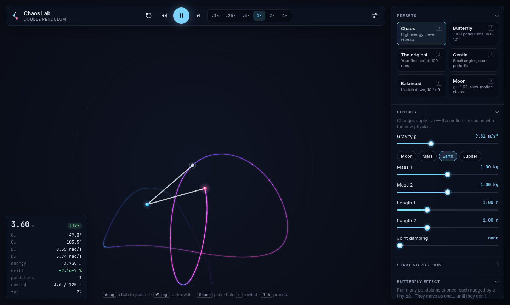
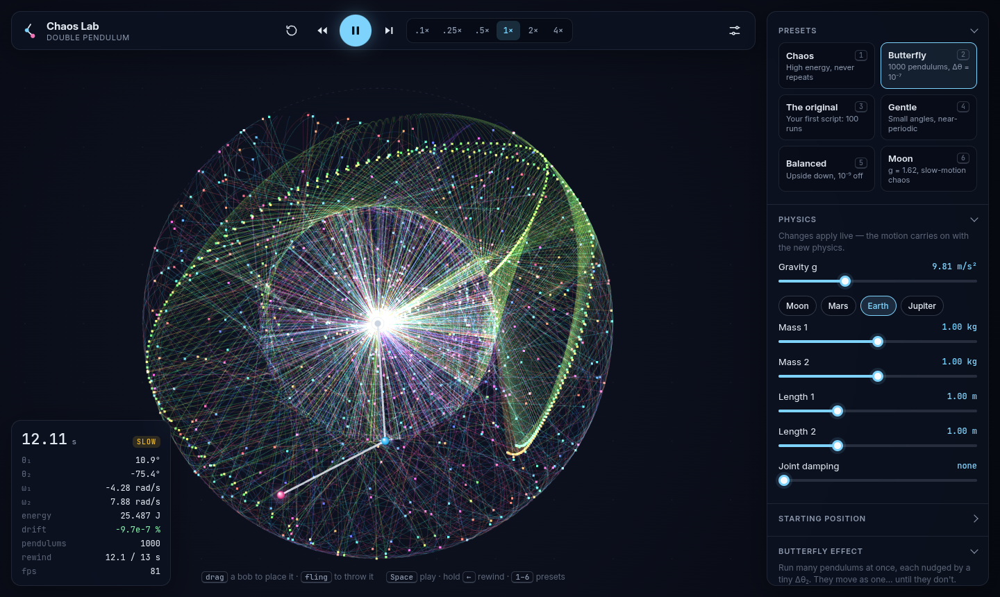
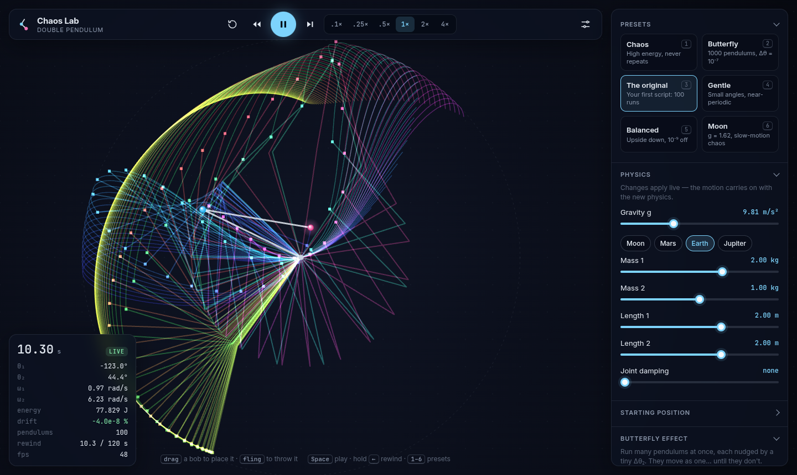
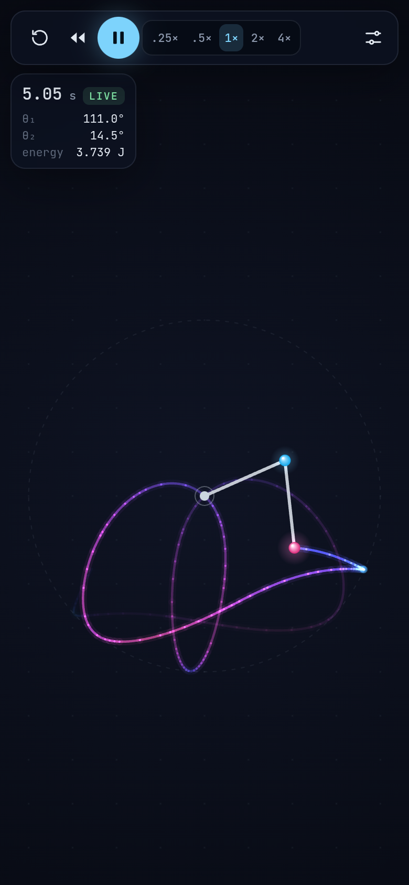

# Chaos Lab: double pendulum

A real-time, interactive double pendulum simulator that runs in the browser. You can grab the bobs and throw them, change gravity mid-swing, rewind time, and run a thousand pendulums side by side to watch the butterfly effect happen.

## Installation

You only need **Node.js 18 or newer**, which is free. Everything else installs itself on the first launch.

### 1. Install Node.js (once)

| System | Easiest way |
| --- | --- |
| **Windows** | Download the **LTS** installer from [nodejs.org](https://nodejs.org/en/download) and run it. Or, in PowerShell: `winget install OpenJS.NodeJS.LTS` |
| **macOS** | Download the **LTS** installer from [nodejs.org](https://nodejs.org/en/download). Or, with Homebrew: `brew install node` |
| **Linux** | Ubuntu 24.04 or Debian 12: `sudo apt install nodejs npm`. Fedora: `sudo dnf install nodejs`. Arch: `sudo pacman -S nodejs npm` |

To check, open a **new** terminal and run `node --version`: it should print `v18` or higher. If your Linux distribution ships an older version, follow the commands for your system on [nodejs.org/en/download](https://nodejs.org/en/download).

### 2. Get Chaos Lab

- **Without Git:** click the green **Code** button at the top of this page, choose **Download ZIP**, then unzip it.
- **With Git:** `git clone https://github.com/yahyabmo/the-double-pendulum.git`

### 3. Start it

| System | What to do |
| --- | --- |
| **Windows** | Double-click `start.bat` in the folder. |
| **macOS** | Double-click `start.command` in the folder. |
| **Linux** | Open a terminal in the folder and run `./start.sh` |

The first launch installs the dependencies, which takes about a minute. Chaos Lab then opens in your browser at <http://localhost:5190>. Later launches take a few seconds. To stop it, close the terminal window, or press <kbd>Ctrl</kbd>+<kbd>C</kbd> in it.

From a terminal, the same thing works on every system:

```bash
cd the-double-pendulum
npm install
npm start
```

### If something goes wrong

| Problem | Fix |
| --- | --- |
| `node` is not recognized, or "Node.js is not installed" | Install Node.js (step 1), then open a **new** terminal or window and try again. |
| "Node.js is too old" | Install the LTS version from [nodejs.org](https://nodejs.org/en/download). |
| Windows shows "Windows protected your PC" | Click **More info**, then **Run anyway**. |
| macOS says the file cannot be opened | Open **System Settings → Privacy & Security**, click **Open Anyway**, then double-click again. Or run `./start.sh` from Terminal. |
| Linux or macOS says "permission denied" | Run `chmod +x start.sh start.command` once in the folder. |
| "Port 5190 is already in use" | Chaos Lab is probably already running: close the other window. Or start it on another port: `npm start -- --port 5191` |
| The browser did not open | Open <http://localhost:5190> yourself. |

## Screenshots



*A single pendulum in chaotic motion. The trail of the lower bob is coloured by speed, and the panel on the left shows angles, speeds and energy.*



*Butterfly mode, 12 s in. 1000 pendulums started 10⁻⁷ rad apart: they moved as one, and now they are flying apart.*



*The original experiment of this project, live: m₁ = 2, m₂ = 1, L = 2, and 100 pendulums offset by 10⁻⁴ rad.*

<p align="center">
  
</p>

<p align="center"><em>On a phone, the panel folds away and the controls stay at hand.</em></p>

## Features

- **Real-time physics.** A fixed-step RK4 integrator runs at 600 steps per second by default. The HUD shows energy drift, which typically stays around 10⁻⁷ of the system's energy scale.
- **Direct manipulation.** Drag either bob to place it. Release it while moving to fling it with that speed.
- **Rewind.** Hold <kbd>←</kbd> or the rewind button to scrub back through the recorded history. This is exact, not re-integrated backwards.
- **Butterfly mode.** Run up to 2000 pendulums at once, each with its θ₂ nudged by a tiny Δθ (down to 10⁻¹²). They move as one, then burst into a rainbow fan.
- **Live physics.** Change gravity (with Moon, Mars, Earth and Jupiter presets), masses, lengths and joint damping while it runs.
- **Glowing trails.** Coloured by speed, by time (rainbow) or a single colour, built from the history buffer so they rewind too.
- **Presets.** Includes *The original*, which replays the setup from the first version of this project: m₁=2, m₂=1, L=2, 100 runs offset by 10⁻⁴.

### Keyboard

| Key | Action |
| --- | --- |
| <kbd>Space</kbd> | play / pause |
| hold <kbd>←</kbd> | rewind |
| <kbd>→</kbd> | step forward |
| <kbd>R</kbd> | reset to start |
| <kbd>C</kbd> | clear trails |
| <kbd>P</kbd> | toggle panel |
| <kbd>1</kbd>–<kbd>6</kbd> | presets |

## How it works

```
physics/derive.py   ──SymPy──▶  src/physics/generated.ts   (equations of motion)
                                        │
src/physics/sim.ts   RK4 ensemble integrator · history ring buffer · energy
src/render/renderer.ts  Canvas 2D renderer (trails, ensemble, glow)
src/ui/controls.ts      tiny dependency-free widgets
src/main.ts             app wiring, input, loop, HUD
```

The equations of motion are derived symbolically from the Lagrangian *L = T − V*, the same approach as the original script, which is kept in [`legacy/`](legacy/). Joint damping enters as a generalized force. The 2×2 mass-matrix system is solved symbolically, simplified with common-subexpression elimination, and emitted as TypeScript. To regenerate after changing the physics:

```bash
pip install sympy
npm run derive
```

The tests check the generated equations against the textbook closed form. They also check energy conservation, exact rewind, and that ensemble members diverge.

## Development

```bash
npm install
npm run dev      # http://localhost:5190
npm test
npm run build    # static site in dist/
```

The site runs locally. `.github/workflows/ci.yml` runs the tests and the build on every push.

## Roadmap

- [x] **Phase 1.** Real-time simulator: drag and fling, live physics, rewind, trails, presets, butterfly ensemble.
- [ ] **Phase 2.** Chaos tools: divergence graph and Lyapunov exponent, phase-space and Poincaré plots, energy charts.
- [ ] **Phase 3.** GPU flip-time fractal map with zoom and click-to-launch.
- [ ] **Phase 4.** N-link chains, share-by-URL, GIF/video export, equations drawer.
- [ ] **Phase 5.** Balance game, swing-up autopilot, sonification, 3D spherical pendulum.
